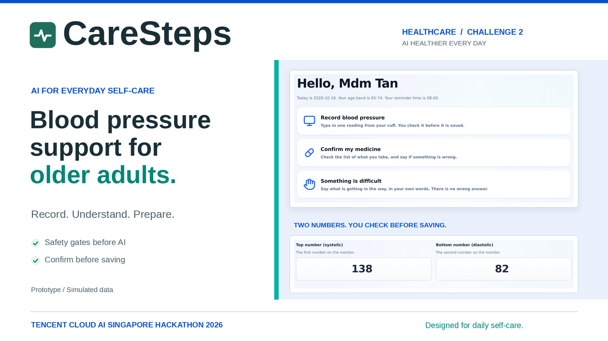

# CareSteps 乐护同行

**Everyday support for seniors managing blood pressure**



CareSteps helps older adults in Singapore follow an existing hypertension care plan:
record blood pressure, understand confirmed medicines, explain difficulties with daily
routines, and prepare a summary for their next appointment.

Tencent Cloud AI Singapore Hackathon 2026 · Healthcare Track (NTU LKC Medicine) ·
Challenge Statement 2: **AI Healthier Every Day** · Scenario: adults aged 65+.

A missing record is a question: the app asks what got in the way, preserves the person's
own words, and offers support appropriate to the reason they confirm.

## Try it locally

Requires Python 3.11 and `make` on Linux, macOS or WSL.

```bash
make setup
make seed
make run
```

Open **http://127.0.0.1:8000/app**. No API key is needed for the local workflows or
limited-mode conversation. `make seed` replaces the local database with fictional data.
For Windows PowerShell and optional model setup, see the [quick start](docs/QUICKSTART.md).

With a model, copy `.env.example` to `.env` and set `LLM_BASE_URL`, `LLM_API_KEY` and
`LLM_MODEL`. The adapter supports an OpenAI-compatible chat-completions endpoint with
function calling. The configured model name does not independently verify the service
behind a gateway. `/trace` shows configuration and actual session events; configuration
alone is not proof of a successful model call.

## What you can do

| Workflow | Behavior |
|---|---|
| Record a reading | Enter → preview → confirm; corrections preserve the previous row. |
| Review medicines | See the fictional care plan and source-linked explanations; report taken, not taken or unsure. Missing reports stay unrecorded. |
| Explain a difficulty | Keep the person's words; optionally confirm a category and choose matching support. |
| Review trends | Code computes counts, averages, coverage and gaps with their time window and denominator. |
| Prepare for a visit | Preview, omit selected content, and print or save a summary. Nothing is automatically sent. |
| Use the assistant | Chat safety gates run before model access; limited mode supports a smaller deterministic conversation. |
| Inspect actions | `/trace` lists tools, rules, source IDs, model configuration and session audit events. |

## Prototype boundaries

All demonstration patient records are fictional. This is a competition prototype,
without clinical validation, clinical review, an accessibility conformance audit or
health-system integration. It cannot diagnose, prescribe or monitor emergencies.
Safety matching and output checks cover known patterns and have limited coverage.

The public demo uses a **shared fictional patient profile**, signed readable session
cookies and no production login. Use fictional inputs only. See the
[architecture and trust boundaries](docs/architecture.md) before deployment.

## Documentation

| Document | Purpose |
|---|---|
| [Quick start](docs/QUICKSTART.md) | Fresh setup, optional model configuration and a short walkthrough |
| [Architecture](docs/architecture.md) | Request flow, trust boundaries, tools, data model and trade-offs |
| [Evaluation](docs/evaluation.md) | Reproduce the automated checks and understand their limits |
| [Demo guide](docs/demo-guide.md) | Judge walkthrough and routing checks |
| [Deployment](docs/DEPLOYMENT.md) | Render/Railway, persistent SQLite and post-deployment checks |
| [Content provenance](docs/content-provenance.md) | Health-source selection, review states and attribution |
| [Design decisions](docs/decisions.md) | Scope choices and their costs |
| [Development workflow](docs/development.md) | Recorded WorkBuddy tasks and verification process |
| [Submission checklist](submission/SUBMISSION_CHECKLIST.md) | Actual form requirements, final files and remaining gates |

## Submission materials

- [Project description](submission/description.md) and [form text](submission/project-info/SUBMISSION_CONTENT.md)
- [9-slide architecture PPTX](submission/architecture-diagram/CareSteps_Architecture_Diagram.pptx)
- [Architecture PDF](submission/architecture-diagram/CareSteps_Architecture_Diagram.pdf) and [diagram overview](submission/architecture-diagram/CareSteps_Architecture_Overview.png)
- [7:22 narrated demo](submission/demo-video/caresteps-demo-gemini.mp4) and [subtitles](submission/demo-video/caresteps-demo-gemini.en.srt)
- [WorkBuddy conversation evidence PDF](submission/tool-evidence/CareSteps_WorkBuddy_Evidence.pdf)

Source code: [MegaArn1/caresteps](https://github.com/MegaArn1/caresteps).
The live application URL and hosted video URL are pending publication.
The local MP4 is a download artifact; the submission form needs a working video link.

## Verify

```bash
make test         # 170 tests
make demo-check   # 27 routing scenarios
```

Tests check software behavior on fictional fixtures; they do not establish clinical
accuracy, accessibility conformance or successful operation of an external model.

## Repository layout

```text
app/             FastAPI routes, safety, model adapter, tools, templates, CSS and JS
content/         Source-linked education entries and authored safety rules
demo-data/       Description of the fictional seed fixtures
scripts/         Database seeding, deterministic demo checks and diagram rendering
tests/           Automated software checks
docs/            Current setup, architecture, evaluation and deployment documentation
submission/      Selected competition materials and their reproducible source scripts
render.yaml      Reviewable deployment blueprint; requires a paid disk-capable service
```

## Attribution

Original application work by the CareSteps team. The recorded development workflow is
described in [docs/development.md](docs/development.md).
Third-party health material is paraphrased with source attribution; see
[content provenance](docs/content-provenance.md). No open-source license is granted by
this README; competition judging access does not itself grant reuse rights.
