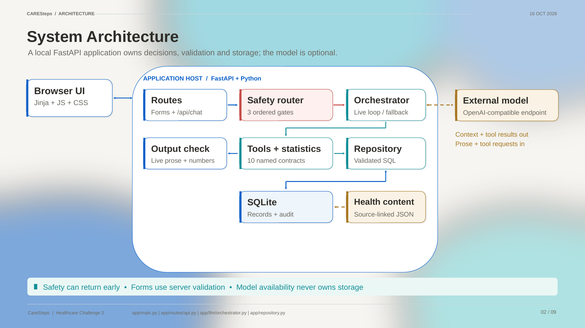
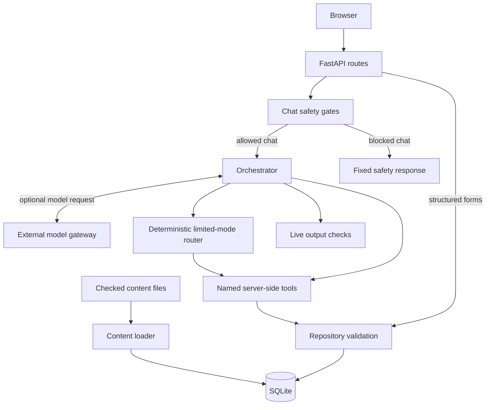
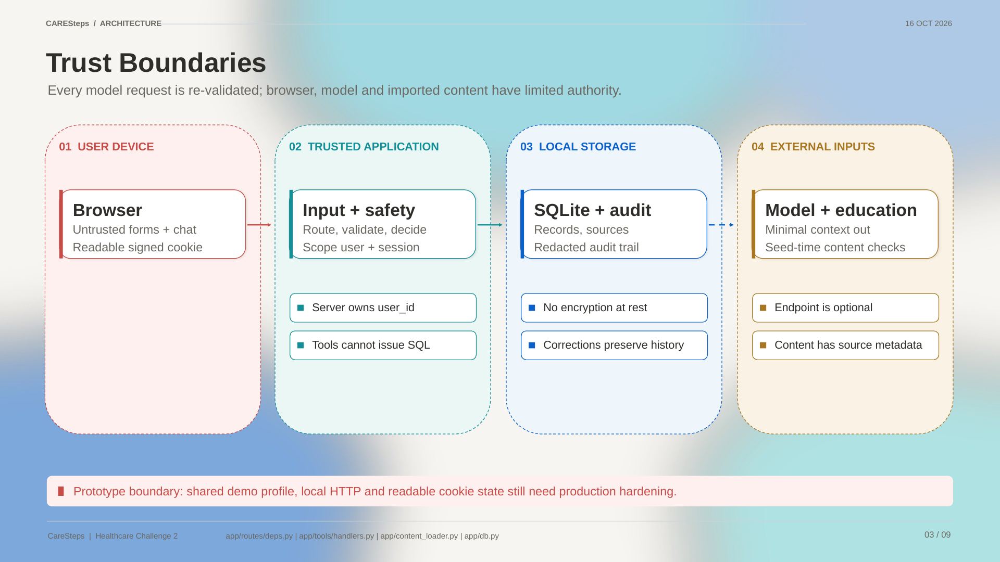
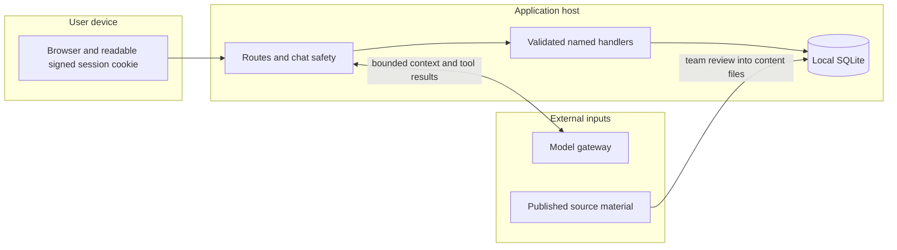

# CareSteps architecture

The application is one FastAPI process, Jinja templates, local CSS/JavaScript and SQLite.
The optional external model must speak chat completions with function calling.
Development tools are described in [development.md](development.md); they are separate
from runtime components.

## System architecture

The safety gate belongs to the **chat turn**. Structured form routes use their own
validation; they do not all traverse the chat gate. `app/main.py` mounts the routes
and static assets. Startup creates the schema. On an empty database the first `/app`
visit admits the checked content and seeds the fictional patient.

## Trust boundaries

- User and model inputs are untrusted. Server-owned `ToolContext` supplies identity;
  models have no SQL tool, database credential or arbitrary URL-fetch tool.
- New browser sessions resolve to the **shared seeded demo profile**. This is not
  production identity or proof that separate browsers own separate patient records.
- Signed cookies protect integrity, not confidentiality. Some draft/session content
  is readable by the browser. The signing key changes on each process restart.
- SQLite is local and unencrypted. Audit records are inspectable, not cryptographically
  immutable. There is no production authorization layer.
- Education/rule metadata records source and review state. `team_checked` means team
  source checking; it does not mean clinical review or verified clinical correctness.

## Chat turn

`app/llm/orchestrator.py` executes the following sequence:

1. `safety.route()` checks red flags, medication/action boundaries, then clarification.
   A blocking verdict returns authored text without a model request.
2. Build a compact profile orientation and up to 12 recent conversation messages.
3. If configured, request a model completion. Execute named tools server-side with
   structural argument checks plus handler/repository validation. Default budget: 4 rounds.
4. Check live prose for known forbidden phrases and unsupported two/three-digit integer
   tokens. Allowed numbers come from tool results and configured safety constants.
   Failed checks replace prose. This is a heuristic, not comprehensive factual validation.
5. Store the reply and audit events, then return mode, tool results and source IDs.

Source IDs are supplied by the local education retrieval path. `/trace` shows current
prompt fingerprint, contracts, rules, configuration and session events. It does not
expose private model reasoning. `live` configuration is not a connectivity probe.

## Tools and confirmation

There are **10 model-visible contracts** in `app/tools/contracts.py`:

| Tool | Purpose |
|---|---|
| `get_care_plan` | Read the confirmed plan and medicine metadata |
| `prepare_reading` | Prepare a blood-pressure draft |
| `prepare_medication_report` | Prepare a medication self-report draft |
| `retrieve_education` | Retrieve admitted source-linked explanation |
| `record_barrier` | Store a scoped difficulty report |
| `get_period_stats` | Compute period statistics in code |
| `get_recent_activity` | Read scoped recent activity |
| `set_reminder_preference` | Store a preference; it does not send notifications |
| `build_visit_summary` | Build the appointment fact table |
| `add_question` | Store a scoped question for a professional |

A separate UI-only `confirm_draft` handler is reached through `/api/chat/confirm`.
Readings and medication reports require that confirmation. `record_barrier`,
`add_question` and `set_reminder_preference` are **direct-write exceptions**. Do not
claim that every model-requested write requires a second click.

Schema declarations are not full JSON Schema validation: the dispatcher implements
structural checks, then handlers/repository code enforce their own rules.

## Failure handling

| Condition | Behavior |
|---|---|
| No configuration or `LLM_FORCE_DEGRADED=1` | Deterministic limited-mode response after safety routing |
| Model fails before tools execute | Deterministic limited-mode response |
| Model fails after tools execute, or round budget ends | Construct text from actual tool results; mode can remain `live` |
| Live output check fails | Replace prose with bounded fallback wording |

A later model failure does not undo an earlier tool write. A whole turn is not an
atomic transaction. The fixed safety route, forms, trends and summary do not depend
on model availability; the conversational fallback supports fewer intents.

## Storage and statistics

The schema defines **13 application tables**: `user_profile`, `care_plan`,
`bp_reading`, `medication_item`, `medication_report`, `barrier_event`, `support_action`,
`consultation_question`, `education_source`, `education_fact`, `audit_event`,
`conversation_message` and `visit_summary`.

Patient fixtures carry simulated-data markers where the schema provides them. Published
education sources are actual source records. Conversation/audit tables use session IDs;
not every table has an `is_simulated` column.

A corrected reading inserts a new row and updates the old row's `superseded_by` pointer.
Statistics exclude superseded rows and retain measurement time separately from entry time.
Medication reports use taken, not taken or unsure; **unrecorded is derived from absence**.
`app/stats.py` computes counts, windows, denominators, averages and missing days.
`app/summary.py` assembles those facts; the model does not calculate them.

Bare `GET /api/stats` returns five operational metrics. `GET /api/stats?days=14` returns
per-user period statistics. `/healthz` checks schema access and reports configuration.

## Design trade-offs and limits

| Choice | Benefit | Cost |
|---|---|---|
| One process and SQLite | Simple fresh clone and inspectable storage | One worker/replica; persistent volume needed |
| Authored pattern safety gates | Local, deterministic ordering before model access | Limited wording coverage and possible false results |
| Source-linked local content | Inspectable admitted explanations | Small knowledge base; no clinical review |
| Draft/confirm for readings and medication reports | User checks values before persistence | Extra step; not applied to every tool |
| Computation outside the model | Reproducible descriptive statistics | Does not establish clinical interpretation |
| No frontend build/CDN | Few runtime moving parts | Manual frontend maintenance |
| Shared fictional profile | Easy judge demonstration | Not suitable for real patient data |
| Optional model and fallback | Local workflows survive model failure | Fallback conversation has narrower capabilities |

No clinical validation, user trial, accessibility conformance audit, real reminder
service or hospital/HealthHub/PTEC integration has been completed. The selected source
corpus does not provide the authority needed for this app to apply a clinical BP
threshold; that is a product scope choice, not a claim about all Singapore guidance.

See [evaluation](evaluation.md), [content provenance](content-provenance.md),
[deployment](DEPLOYMENT.md) and the [editable deck](../submission/architecture-diagram/README.md).
