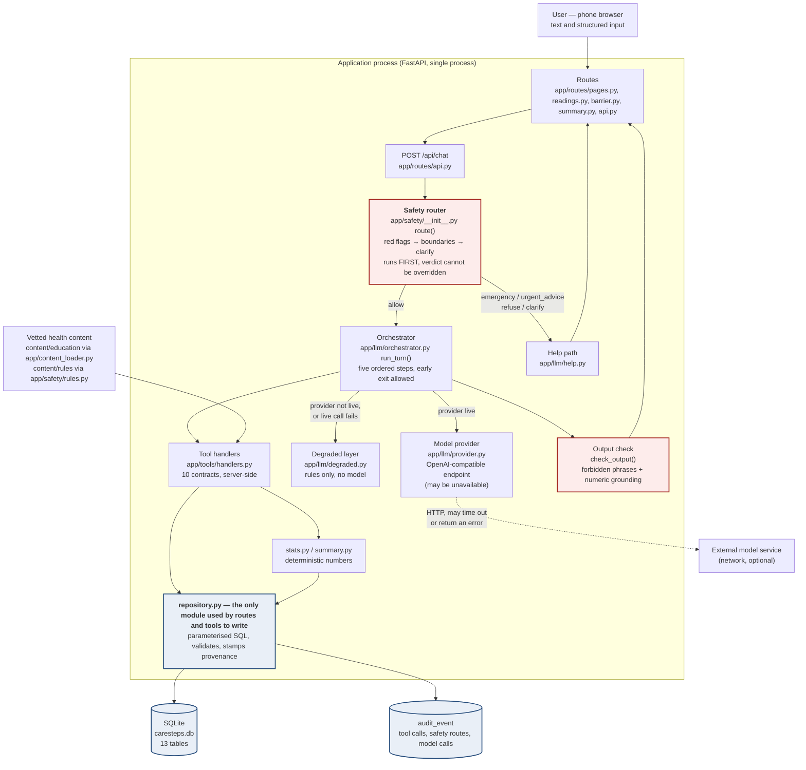
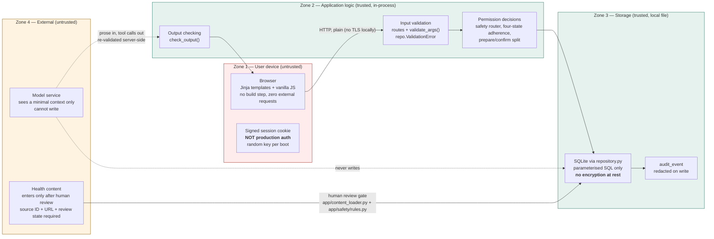

# CareSteps — Architecture

Every claim in this document is checkable in the code. File paths and function names
are given so a reader can verify rather than trust.

**Prototype status.** This is a competition prototype, not a medical device.

- Nothing has been clinically validated or clinically reviewed. Every enabled rule and
  every education entry carries `review_state = team_checked`, which means a team member
  read the source and recorded it. It does not mean a clinician looked at it. Two rules
  are held back and carry `pending_review` instead.
- No hospital, HealthHub, or PTEC system integration exists.
- All patient data is fictional and labelled `is_simulated` at row level. The demo
  patient is Mdm Tan, created by `app/demo/seed.py`, whose 14 days of history were
  written to exercise the app's gaps rather than observed from a patient. (`seed.py`'s
  docstring narrates her as 72; the database stores an age band, `65-74`, and never a
  birthdate or a number.) She is not a real person.
- **The live model path has never been exercised.** No endpoint was ever successfully
  called during the build. `_live_turn` in `app/llm/orchestrator.py` has had static
  review only, and so has the degraded layer: the test suite exercises the repository,
  rules, statistics and summary, but imports no part of `app/llm/degraded.py` or
  `app/llm/orchestrator.py`. Degraded mode has been walked by hand against the running
  app. See "What is not verified" at the end.
- No accessibility conformance audit (WCAG certification) was performed. The stylesheet
  was *designed for* stated accessibility targets; see the trade-offs table.

---

## 1. System architecture

Reading the diagram:

- The safety router has one inbound edge from the chat endpoint and no inbound edge
  from the model. The model cannot reach it, so it cannot influence it.
- `Safety` can return to the user without ever crossing to `Orch`. That is the whole
  point: an emergency message can be answered with the model switched off, absent, or
  slow.
- `Repo` is the only node in the request path with an edge into `DB` for writes.
  Everything else that reads the database does so through the same module.
- The model (`External model service`) is drawn with a dotted edge because it is
  optional. Nothing else in the diagram depends on it being reachable.
- `Check` is fed from `Orch`, not from `Tools` or `Degraded`. `check_output()` is called
  in exactly one place — `_live_turn`, at line 340 of `app/llm/orchestrator.py` — so it
  screens model prose and nothing else. The safety router's fixed messages and the
  degraded layer's rule-driven text never pass through it, and both of those are fixed
  strings the app writes itself rather than model output.

Note on the schema: `app/db.py` creates **13** tables, not 10. An earlier note in
`docs/BUILD_LOG.md` said 10. The 13 are listed in section 7. The discrepancy is
recorded rather than quietly fixed, because the build log is a process record.

---

## 2. Trust boundaries

Four trust zones, not three. The application zone is split in two because the code
that decides *whether* a write is permitted is a different kind of thing from the code
that *performs* it, and conflating them would hide the most important boundary in the
system.

Key properties, each of which is an assertion about code:

| Property | Where it is enforced |
|---|---|
| The model cannot write to storage. | There is no SQL tool. `app/tools/contracts.py` defines 10 tools, none of which executes arbitrary SQL, fetches a URL, or calls code by name. Every handler in `app/tools/handlers.py` and every write route in `app/routes/` goes through `app/repository.py`, which uses parameterised statements. The two exceptions in the codebase are outside the model's reach and outside the request path: `app/demo/seed.py` issues one raw `INSERT` and two raw `UPDATE`s to age the demo history, and `app/db.py` creates and drops tables as schema management. |
| Content enters only after human review. | `app/content_loader.py` refuses to load a fact with no source. `app/safety/rules.py` drops any rule whose `sources` list is empty, and records it as a load problem. A fact with `enabled = 0` is never retrievable. |
| The model sees a minimal context. | `_live_turn` sends the system prompt, a two-line factual orientation (display name, age band, reminder time, today's date), the last 12 conversation messages, and tool results. Not the whole record, not other users' rows. |
| Source IDs come only from retrieval. | `source_ids` is populated in exactly one place: the branch in `_live_turn` that checks `"retrieve_education" in call.name`. A source ID the model invents in prose is not a source ID the app will cite. |
| Tool results are scoped to one user. | `ToolContext` carries `user_id`; every handler passes it to the repository; repository functions filter on it. `tests/test_data_integrity.py::test_reports_cannot_cross_profiles` locks this. |
| Health text is redacted before it reaches the log. | `repository.audit()` applies `_redact()` to arguments and `_redact_text()` to detail as a backstop, so a careless caller cannot leak a credential into the trace. |

The cookie in Zone 1 is a signed session identifier with `https_only=False` because the
demo runs over plain HTTP on localhost. It demonstrates session-to-session data
isolation and nothing more. It is not authentication, and this document does not claim
it is.

---

## 3. The five-step turn pipeline

`app/llm/orchestrator.py::run_turn` implements a fixed sequence, from which a safety
verdict may exit early. The ordering is the architecture; the individual steps are
ordinary.

| # | Step | What happens | Why it is in this position |
|---|---|---|---|
| 1 | **Safety route** | `safety.route(message, context)` runs all three gates in priority order: red flags, then boundaries, then clarification. If the verdict `blocks_model`, `run_turn` returns immediately with mode `safety` and steps 2–5 never execute. | Must be first. See below. |
| 2 | **Build context** | The orchestrator assembles the small orientation block and replays the last 12 messages. | The model does not get to *ask* for its own context and act on it. Pre-loading a small, fixed set limits what a stale or malformed value can anchor on. |
| 3 | **Model loop** | Up to `LLM_MAX_TOOL_ROUNDS` (default 4) rounds. Each tool call is re-validated with `validate_args` against its JSON Schema, then dispatched server-side. Each call is written to `audit_event` as one row carrying its result status. | Tool execution is server-side by construction. The model asks for a named operation; it does not perform one. |
| 4 | **Output check** | `check_output` scans the final prose for forbidden phrasing and ungrounded numbers. On failure the text is **replaced**, not patched. | Runs on whatever prose is about to be shown, after the model has finished, so it cannot be routed around by an intermediate turn. |
| 5 | **Persist and return** | `run_turn` returns a `TurnResult`; the caller (`POST /api/chat` in `app/routes/api.py`) writes the assistant message with its mode (`live` / `degraded` / `safety`), payload, tool calls and sources. | Persisting after the turn means the trace page shows what was actually returned, not a re-enactment. The write lives in the route rather than in `run_turn`, so an orchestrator call that fails mid-way still leaves the user's message on record. |

The number of steps is only fixed for a turn that reaches the model: a safety verdict, and
a call to the degraded layer, both leave at an earlier exit. What is genuinely fixed is
that no path reaches the model before the safety router has run.

### Why safety is evaluated before the model is ever called

If safety ran after the model, then a red-flag message would pass through a language
model on its way to the user. Three things follow, all of them bad:

1. **Delay.** A model call has a timeout measured in tens of seconds
   (`LLM_TIMEOUT_S`, default 30). A chest-pain message must not wait on a network round
   trip, let alone a retry.
2. **Rewording.** A model asked to "be careful with the emergency message" may
   paraphrase, soften, or append. Each patient message in `content/rules/redflags.json`
   is fixed text carrying the fixed number `995`, and that same number is configured in
   `content/rules/emergency.json`, which the help page reads. Rephrasing it is a defect,
   not a flourish.
3. **Availability.** If the model is down, a post-model safety step is down with it. In
   this design the emergency path shares no dependency with the model. `run_turn`
   reaches `if verdict.blocks_model: ... return` before it ever reads
   `get_provider().s.live`.

A rule that only exists in a prompt is a suggestion. A rule that runs before the prompt
and can return without it is a rule. `SafetyVerdict.blocks_model` in
`app/safety/__init__.py` is where that distinction is implemented, and its docstring
says so.

`tests/test_safety.py` locks the ordering directly:
`test_emergency_beats_a_medication_request` and `test_emergency_beats_a_clarification`
feed inputs that would satisfy a lower gate as well, and assert that the emergency
verdict wins.

### Why the gates are ordered red flags → boundaries → clarify

Declining to act is not the only possible wrong answer. Saying something confidently
wrong is another. The order resolves conflicts in favour of the answer that is most
costly to get wrong:

- A red flag beats everything. The app must be willing to abandon a form mid-way.
- A boundary ("I am not permitted to advise on a dose") beats a clarification ("I do not
  know what you are asking"), because a refusal is final and a clarification invites
  another turn. Answering a dose-change request with "which medicine do you mean?" would
  walk the user toward advice.
- Clarification is last, and is cheapest.

The order is not configurable at runtime. It is a `for` loop over severity in
`app/safety/redflags.py` and three sequential `if` blocks in `route()`. There is no
setting that changes it.

---

## 4. Tool safety

Ten tools are defined in `app/tools/contracts.py` as explicit JSON Schema, and executed
in `app/tools/handlers.py`. One further handler, `confirm_draft`, lives in the handlers
module only and has no schema at all, which is the stronger form of the same control: a
tool that has no contract cannot be advertised to the model. The table below therefore
has eleven rows against ten schemas, and the eleventh is marked as such. The docs in
`/trace` are generated from the same list the model is given, so the published contract
and the live contract cannot drift.

| Tool | Kind | Writes? |
|---|---|---|
| `get_care_plan` | read | no |
| `prepare_reading` | prepare | no |
| `prepare_medication_report` | prepare | no |
| `retrieve_education` | read | no |
| `record_barrier` | record | yes — the user's own words |
| `get_period_stats` | read | no |
| `get_recent_activity` | read | no |
| `set_reminder_preference` | write | yes — app reminder only |
| `build_visit_summary` | prepare | no |
| `add_question` | record | yes — user's own question |
| `confirm_draft` *(handler only, no schema)* | confirm | yes — **UI-only, never advertised to the model** |

### The contract layer

The schemas use `"additionalProperties": false` throughout, and each declares its
`required` list — `get_care_plan` has no `required` key because it takes no properties
at all. `validate_args()` in `app/tools/handlers.py` is deliberately not a full JSON
Schema implementation. It checks the properties that matter for safety — unknown keys,
missing required keys, enum membership, basic types — and rejects the call before
dispatch.

### Server-side re-validation

A schema can say "this is a string". It cannot say "this is not a dose suggestion". So
every handler re-validates what it needs to:

- `h_prepare_medication_report` rejects `status == "unrecorded"` with an explanation,
  even though the enum already excludes it. Two gates, because this one is the difference
  between "the patient said they skipped it" and "we have no record", and conflating them
  would manufacture an adherence signal out of an absence.
- `h_prepare_medication_report` refuses to guess a medication from a name that does not
  match the confirmed list. It returns an error telling the model to ask.
- `h_retrieve_education` re-checks the topic against an allow-list rather than trusting
  the enum alone.
- `dispatch()` returns an error for an unknown tool name rather than raising, so a
  hallucinated tool produces a truthful failure instead of a 500.

### Why there is no SQL tool

The absence is the control. A generic query tool would make "the model cannot write to
storage" a matter of what the model chose to send. Instead the model can only request
*named* operations with *schema-validated* arguments. There are also no tools that
change a dose, stop a medicine, send a message, or contact anyone — not disabled ones,
absent ones. `app/tools/contracts.py` states this in its module docstring, and the list
above is the check.

### Why prepare/confirm is structural rather than behavioural

The two-phase split is what turns a prompt instruction into a property of the program.

- `prepare_*` validates and returns a draft. It writes nothing. The draft lives in
  `ToolContext.drafts`, which is in-memory and scoped to the turn.
- `confirm_draft` would persist a draft. It is in `UI_ONLY_HANDLERS`, so `dispatch()`
  refuses it whenever `allow_ui_only` is left at its False default, and it has no entry
  in `TOOL_SCHEMAS` at all, so `schemas_for_model()` never passes it to the model.
- In the code as it stands, nothing calls `dispatch()` with `allow_ui_only=True`: the
  flag exists and is enforced, but no caller sets it, so `confirm_draft` is unreachable
  from every path in the running app. This is a narrower guarantee than "the UI uses
  it" and it is the true one — the UI confirm buttons for readings and medication go
  straight to `repository.confirm_reading` / `repository.record_medication_report`.

So the model does not need to be *well-behaved* about writes. It has no reachable
code path that writes on its own. `tests/test_data_integrity.py::test_prepare_writes_nothing`
asserts the first half; the absence of a schema for `confirm_draft` is the second.

The same pattern applies to readings outside the chat: `POST /readings/prepare` stores
the draft in the session and renders a confirmation page; `POST /readings/confirm` is a
separate request that reads the draft back out of the session. A client cannot POST
values straight into storage without having been shown them.

---

## 5. Output checking

`check_output()` runs on the model's prose before it is shown. It is called from one
place, `_live_turn`, so it screens the live path only; the safety router's fixed
messages and the degraded layer's rule-driven text do not pass through it. It applies
two checks. Both are deliberately crude and auditable.

### Forbidden-phrase regexes

Five patterns in `FORBIDDEN_PATTERNS`, each targeting a specific way this app could
cross a line:

| Pattern targets | What it catches |
|---|---|
| `you should (take\|stop\|skip\|start\|change\|increase\|decrease\|double)` | drifting into medication advice |
| `(i have\|i've\|i will) (sent\|shared\|emailed\|booked\|ordered\|contacted\|notified)` | claiming an action the app cannot take |
| `(you are\|you're\|this is) (safe\|fine\|nothing to worry about\|normal)` | reassurance the app is not entitled to give |
| `(stop\|skip) (your\|the) (medication\|medicine\|tablet\|pill)` | advising a stop |
| `your (medication\|medicine) is causing` | asserting causation between a drug and a symptom |

A subtle classifier would be harder to audit than five obvious patterns. The goal is to
catch the failure loudly and in a way a reviewer can read in ten seconds, not to
maximise recall. A pattern that does not match is a miss; a pattern nobody can read is a
liability.

### Numeric grounding

`_NUMBER_RE` extracts every two- or three-digit number from the prose. Each one must
appear in `allowed_numbers`, which is built from `_collect_numbers()` walking every tool
result, plus a small set of legitimate constants.

The constants matter and were a bug once. The emergency number `995` is a configured
value; a model citing it correctly would have failed the check as a hallucination. The
fix was to source the allowed constants from the rule files at turn time
(`RULES.of_kind("red_flag")` → digits from each `patient_message`), not to hard-code
them, so the numbers allowed in prose follow the content rather than a literal in the
orchestrator. See `docs/BUILD_LOG.md`, P3.

Two numbers are admitted by this route — `995` and `6262` — because both appear in a
red-flag message. Note what this does *not* buy: the help page reads its number from
`content/rules/emergency.json` (`primary.number`), while the allowed constants come from
the `patient_message` fields in `content/rules/redflags.json`. Those are two different
files, so a change to one and not the other would still diverge. Sourcing the constants
from the rule set removes the hard-coded literal; it does not make the two files
mutually consistent, and nothing in the build currently enforces that they agree.

Grounding a float is handled explicitly: a mean of `142.5` rounds to `142` under the
banker's-rounding `round()` builtin, and the code admits `rounded - 1`, `rounded` and
`rounded + 1` — so `141`, `142` and `143` are accepted, because a model writing "about
143" is being accurate, not hallucinating. The band is a fixed ±1 either side of the
rounded value, so `144` on a `142.5` mean would be rejected.

### Why a failed check replaces rather than patches

On failure, `_grounded_fallback()` returns a fixed paragraph that names the *kind* of
problem and offers two constructive routes. It does not attempt to repair the model's
sentence.

The reasoning is that drift is not random. A model that produced an ungrounded average
produced it because the turn invited a number-shaped answer, and asking that same model
to rewrite the sentence in the same context tends to produce a second sentence with the
same defect. Repair also keeps the fluent surface while changing the substance, which is
the worst combination: the user cannot tell that anything went wrong.

Replacement is visibly less fluent. That is the intended cost. A user who notices "the
app stopped itself" is better served than a user who reads a smooth, wrong number. The
substituted text is:

> I started to answer that but I could not make it match your records, so I have stopped
> rather than give you something inaccurate. The problem was: {detail}. I can show you
> the recorded numbers instead, or add this to your questions for your doctor or
> pharmacist.

The audit log records the failure with `tool_name="output_check"` and
`result_status="refused"`.

---

## 6. Degraded mode

Degraded mode is not a stub and not an error page. It is a working, rules-driven layer
in `app/llm/degraded.py`, and it is entered in three ways:

1. No `LLM_BASE_URL` / `LLM_MODEL` configured.
2. `LLM_FORCE_DEGRADED=1` — used to demonstrate and test the fallback without
   unplugging the network.
3. The model was configured but the call failed and no tool had completed yet
   (`_live_turn` returns `_degraded_turn(..., reason=result.error)`).

The third case is the honest one. If the model fails *after* tools have run, the
orchestrator does not discard the work: it builds a sentence from what the tools
actually did (`_fallback_text_from_tools`) and says plainly that nothing was saved.

### What still works with no model

From `summarise_degraded()`, which is the list rendered on `/trace`:

| Available | Unavailable |
|---|---|
| Record and confirm a blood pressure reading | Explaining what a medicine is for (retrieval needs the model layer) |
| Report medication status in four separate states | Understanding free-text phrasing outside the listed phrases |
| Record an execution difficulty and choose a support | Drafting the summary introduction in natural language |
| View computed statistics with sample size and gaps | |
| Preview, edit and print a visit summary | |
| The emergency help path with the verified local number | |

The intent router `classify_intent()` is a crude keyword matcher, deliberately so. A
clever classifier here would imply the degraded path understands language as well as the
model does. It does not, and saying so is the feature.

### The explicit guarantee

> Nothing is generated from model memory in this mode. Where the app cannot help, it says
> so rather than substituting a guess.

Two mechanisms carry that guarantee, and it is worth being precise about which one is
live. A medicine question from this user gets a boundary refusal from the safety router
before the model question arises at all, and that refusal text points at a pharmacist
(see `content/rules/boundaries.json`). If such a question did reach the degraded layer, it
falls into `classify_intent`'s `unknown` branch, which says the free-text part is not
working and offers the buttons. `UNAVAILABLE_MESSAGE` in `app/llm/degraded.py` is a third,
more explicit refusal written for that case — it is defined but no branch of `reply()`
currently emits it, so it should be read as text held in reserve rather than as the
mechanism the user sees. What matters is the same in all three: nothing is invented, and
the user is pointed at a pharmacist or doctor. Explaining a drug badly is worse than
declining to explain it.

Everything the degraded path can do was arithmetic or lookup before the model existed —
`stats.build_period_stats()`, `summary.build_summary_facts()`, `repository` reads,
`content/rules/emergency.json`. None of it was ever model-derived, so none of it degrades.

The build log records the ordering bug found here: `record_reading` was checked before
`barrier` in `classify_intent`, so "I keep forgetting to write down my readings" was
answered as a reading entry, because the word "readings" contains "reading". A false
refusal or a false misroute is worse than a miss in this domain, because it penalises the
behaviour the app exists to support.

---

## 7. Data model

`app/db.py` defines the schema as one SQL string, deliberately bare rather than through
an ORM. There are **13 tables**, grouped below. (An earlier BUILD_LOG note said 10; the
code is the source of truth.)

| Module | Table | Holds |
|---|---|---|
| M0 Profile & plan | `user_profile` | display name, age band (never a birthdate), language, reminder time |
| M0 | `care_plan` | the user's existing plan, verbatim, with per-item source and three verification flags |
| M0 | `medication_item` | medicine name as confirmed by the user, optional education link |
| M1 Readings | `bp_reading` | systolic, diastolic, pulse, `measured_at` **and** `entered_at`, correction chain, `dedupe_key` |
| M2 Medicines | `medication_report` | one of four states, `is_self_report`, `is_backfilled` |
| M3 Barriers | `barrier_event` | the user's own words verbatim, proposed category, `category_confirmed` |
| M3 | `support_action` | a chosen support, with `basis_type` / `basis_id` so no action is sourceless |
| M4 Knowledge | `education_source` | publisher, title, URL, retrieval date, review state |
| M4 | `education_fact` | our own paraphrase, topic, subject, `enabled`, review state |
| M5 Summary | `visit_summary` | period, the fact table as JSON, omissions, whether the user edited it |
| M5 | `consultation_question` | questions for the doctor, with origin and inclusion flag |
| M6 Conversation | `conversation_message` | one turn: role, content, structured payload, mode |
| M6 Audit | `audit_event` | tool calls, safety routes, model calls, errors |

### Provenance columns

Provenance is not one flag. It is recorded at three levels, because they answer three
different questions:

- **Per-row simulation flag.** `is_simulated` marks data created from demo fixtures.
  Present on 10 of the 13 tables. It is absent from `education_fact`,
  `conversation_message` and `audit_event` — education facts are real published content
  paraphrased, and messages and audit lines are records of what happened in a session
  rather than observations. The claim in `docs/BUILD_LOG.md` that *every* table carries
  this column is wrong as written; 10 of 13 do.
- **Per-fact source.** Every education fact joins to an `education_source` row with a
  publisher, URL and retrieval date. Every safety rule declares `sources` in JSON, and
  `app/safety/rules.py` drops any rule that declares none.
- **Three separate review-status fields.** See below.

### The three review-status columns

These are three questions, and a product that answers them with one column will
overstate its own safety. All three columns live on `care_plan`:

| Column | Question | What a "yes" means |
|---|---|---|
| `verified_by_user` | Did the patient confirm this? | The user agrees this is what their plan says. It says nothing about whether it is correct. |
| `verified_by_team` | Did we check it against a source? | A team member read the cited page. It is not a clinical judgement. |
| `reviewed_by_clinician` | Did a clinician sign off? | **Never set to 1 anywhere in this prototype.** `app/db.py` defaults it to 0, and the only code that reads it is the passthrough in `h_get_care_plan`; nothing writes a 1. |

`medication_item` does not carry these three columns. It has a single
`confirmed_by_user` flag, so a medicine name and a plan instruction are not tracked at
the same resolution. That is a real gap in the model rather than a deliberate narrowing,
and it means the medicine table records *who confirmed the name* without recording, per
medicine row, whether the team checked it or a clinician reviewed it. The caution below
still applies: a user-confirmed medicine name does not mean the drug entry was
pharmacist-reviewed. `h_get_care_plan` returns the flags it has to the model and adds an
explicit caution in its message, so the model is not left to infer that "confirmed" means
"medically checked". `tests/test_data_integrity.py::test_three_review_states_are_independent`
locks the independence of the three, on `care_plan`.

### Two columns that must never be merged

- `bp_reading.measured_at` is when the cuff was on. `bp_reading.entered_at` is when the
  row was created. Backfilling is normal and expected; silently rewriting the timestamp
  would misrepresent the data. The UI shows both.
- `medication_report.is_self_report` is 0 for derived rows.
  `repository.record_medication_report` raises `ValidationError` on `unrecorded`, so
  that state can only ever be derived by `derive_unrecorded()` and is never persisted as
  something the patient said. The build log records this as the project's most important
  self-correction.

---

## 8. Design trade-offs

These are real choices with real costs. The cost column is not a formality.

| # | Decision | Why | What it costs |
|---|---|---|---|
| 1 | **Bare SQL over an ORM** (`app/db.py`, `app/repository.py`) | The schema is the specification. A judge can read it in one sitting and it can be explained live without a translation layer. | No migrations. Schema changes mean dropping the database. Acceptable for a prototype with fictional data; a clear debt for anything else. No compile-time check that a query matches the schema — errors surface at runtime, in tests. |
| 2 | **No frontend build step** (Jinja2 + vanilla JS + one CSS file) | A fresh clone goes from nothing to a running demo with no network dependency. The most likely way to lose this competition is failing to start on the judging machine. `make run` cannot fail on an npm resolution. | No component model, no type-checked templates, no bundler optimisations. Template errors are runtime errors — and this cost was paid: all 13 pages returned 500 for a period because `TemplateResponse` takes `request` first in the pinned Starlette version. Locking versions was not enough; the server had to actually be started. |
| 3 | **Eight checked medication-purpose entries, not a drug database** (`content/education/facts.json`, 23 enabled facts across 14 sources) | Every statement was read against the page it cites in an adversarial pass. That pass rewrote 14 statements. A drug database we had not verified would have been a liability, not a feature. | The eight break down as two named drugs, five drug classes, and one entry about taking several medicines at once. That is a small fraction of what a real patient takes. A user on a drug we have no entry for gets "I cannot answer reliably from the information I have" plus an offer to add it to their questions. That is honest, and it is also a worse experience than a correct answer would be. |
| 4 | **English only** | The target demo and the judging context are English. The team's time went into the safety work instead. | The Singapore user base this app describes is substantially multilingual. The plan lists a second language as P1 and it was not delivered. The app must not be described as multilingual. |
| 5 | **All statistics deterministic, model may only rephrase** (`app/stats.py`) | Removes the largest class of hallucination in a health app. Numbers become independently checkable: `/api/stats` returns the same structure the page renders. | The model is weaker than it needs to be. It cannot answer "is that higher than last week?" without a tool call, and if no tool returns the comparison it must say it cannot answer. | 
| 6 | **Two model paths maintained: live and degraded** (D7) | A demo that dies with the conference wifi is not a demo. Degraded mode is a first-class citizen, not a fallback page. | Two conversation paths to keep consistent, and a routing layer (`classify_intent`) that only exists because of the second. Any change to the conversational surface has to be considered twice. |
| 7 | **Single demo character** (Mdm Tan, age band `65-74`) | A six-minute demo can only follow one person's story; auxiliary scenarios are separate branches rather than extra people the judge has to track. Six minutes is the run-sheet target in `docs/demo-guide.md`, not a measured result. | No evidence that the flows work for a second profile with different gaps. Data isolation between users is tested at the repository level, not demonstrated end-to-end with two populated patients. |
| 8 | **Corrections supersede rather than overwrite** (`superseded_by` / `corrects`) | M1 requires the revision history to survive. A correction that destroys the original is not auditable. | Every read of "the current reading" must follow the chain. Simpler queries that ignore it return superseded rows. The initial implementation only changed the value and kept no original; that was a defect found during the build, not a design. |
| 9 | **Output check replaces text instead of repairing it** | A model that drifted once will likely drift again in the repair. | The user sometimes sees a visibly stilted refusal where a smooth-but-slightly-wrong answer would have passed unnoticed. Accuracy is chosen over polish, deliberately. |
| 10 | **Rules as data with a mandatory `sources` field** (`content/rules/*.json`) | A reviewer can read every trigger and citation without reading Python, and an uncited rule cannot ship — the loader drops it. | Adding a rule means editing JSON and restarting. No runtime rule authoring. Rule changes need a version bump or the trace page's `rule_version` becomes misleading. |

---

## 9. What this design does not address

Stated plainly, because a threat model that only lists what is handled is marketing.

| Not addressed | Consequence |
|---|---|
| **No production authentication.** A signed cookie with a per-boot random key identifies a browser session. Any device that obtains the cookie is that user. | The prototype demonstrates session isolation and supports a public demo. It is not a login system, and no user account exists to log into. |
| **No encryption at rest.** `caresteps.db` is a plain SQLite file. | Anyone with file access reads everything. Mitigated only by the data being fictional. For real patient data this is disqualifying on its own. |
| **No encryption in transit.** The demo runs over plain HTTP on `127.0.0.1`, and `SessionMiddleware` is configured with `https_only=False`. | Fine for localhost. Any deployment over a network without TLS would expose traffic including the session cookie. |
| **No rate limiting.** Nothing throttles requests to `POST /api/chat` or any other endpoint. | A client can drive unlimited model calls where a model is configured, and unlimited writes otherwise. No cost control, no abuse control. |
| **No multi-tenancy hardening.** Isolation is a `WHERE user_id = ?` clause applied consistently, plus a session lookup. There is no row-level security, no per-tenant key, no tenancy boundary in the storage layer. | A missed filter in a future repository function would be a cross-user read, caught only by a test. `test_reports_cannot_cross_profiles` covers the paths that exist today. |
| **No audit tamper-evidence.** `audit_event` is append-only by convention. Nothing hashes the chain, nothing signs it, and a process with database access can edit or delete rows. | The trace page is a faithful record of what the running system did, not a forensic one. It cannot prove the absence of a deleted line. |
| **No clinical validation, clinical review, or user testing.** No clinician reviewed any rule or fact. No older adult was observed using the app. | Every safety property in this document is a property of the code. None of it has been tested against a real patient, a real clinical judgement, or a real emergency. Every rule and fact is `team_checked` or held back at `pending_review`; nothing is `clinician_reviewed`. |
| **The live model path is unexercised.** No call to a configured endpoint has ever completed. | The orchestrator's tool loop, provider error handling, argument parsing and the output-check integration on live prose are all statically reviewed only. Neither live mode nor the degraded conversation layer is covered by the test suite — the suite exercises the repository, safety rules, statistics and summary, and imports no part of `app/llm/` except `help.py`. The degraded path has been walked by hand. |
| **Content is a hand-checked set, not a curated corpus.** 14 sources, 23 enabled facts, all `team_checked`. | Recall is low by design. The app declines more often than a general-purpose assistant would, and that is the intended behaviour rather than a defect to be fixed by loosening retrieval. |
| **Accessibility was designed for, not audited.** 19px base type, 48px tap targets, contrast chosen to meet WCAG AA, colour never the only signal, zero external requests so no font fails. | No conformance audit was run. No assistive-technology testing was performed. Stating design targets is not the same as claiming conformance, and this project does not claim it. |

### Outstanding submission requirement

The CodeBuddy / WorkBuddy usage evidence required by Handbook p.37 is **not satisfied**.
The requirement is a hard submission gate: without it the entry does not reach scoring.
`submission/tool-evidence/` exists but contains no evidence — only a README that states
the gap and what would close it. This is recorded here because an architecture document
that presents the system as submission-ready would be misleading about the single
largest gap between this prototype and a valid entry.

---

## Verification status

| Claim | Status |
|---|---|
| 162 automated tests pass (`make test`) | Verified — run on 2026-10-11 |
| Safety router runs before the model and its verdict is not overridden | Verified by code path and by `tests/test_safety.py` |
| The model has no reachable path that writes | Verified: no SQL tool, and `confirm_draft` has no schema so `schemas_for_model()` never emits it |
| No rule or enabled fact contains a numeric BP threshold | Verified by two tests that scan the content files |
| The degraded path works without a model | Verified by running the app through the demo cases. **Not** verified by the test suite — no test imports `app/llm/degraded.py`. |
| The **live** path works against a real endpoint | **Not verified.** Statically reviewed only. |
| Clinical review of rules or content | **Not done.** `team_checked` throughout, plus two rules held at `pending_review`. |
| Accessibility conformance | **Not audited.** Designed for stated targets. |
| Real device, real patient, real integration | **None.** No hospital, HealthHub or PTEC integration exists. |

All patient data in the demo is fictional. Mdm Tan is a fixture written by
`app/demo/seed.py`, and her two weeks of history were designed to contain the gaps the
app is built to notice. Counting the 14-day window the app opens on: 4 days with no
reading, consisting of one isolated day plus a deliberate three-day run; 2 days with no
medication report; one backfilled entry; one corrected reading (the superseded original
is still in the table); and one open plus one resolved difficulty.

Counts in this document were taken on 2026-10-11 against the seeded database, and the
two dates above move with the calendar: `app/demo/seed.py` builds its window relative to
`date.today()`, so the absolute dates in the seed output will differ on a later run even
though the shape of the history does not.
