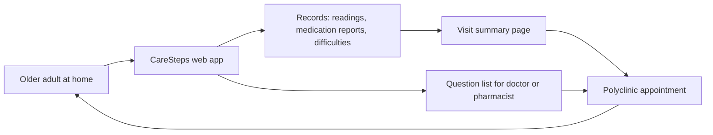
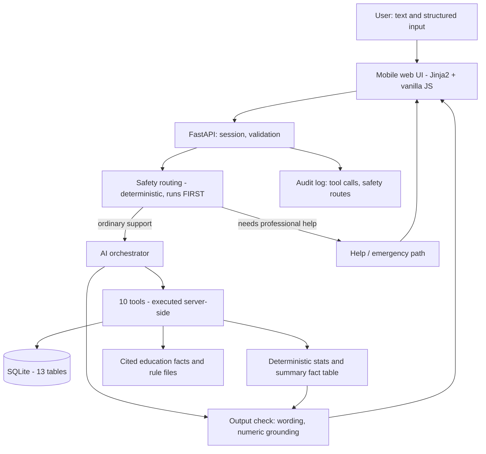

# CareSteps 乐护同行

**Tencent Cloud AI Singapore Hackathon 2026**
**Track 6: The Healthcare Track (NTU LKC Medicine)**
**Challenge Statement 2: "AI Healthier Every Day: Intelligent Support for Long-Term Self-Care"**
**Scenario 3: Hypertension Management for Older Adults (Age 65+)**

**Short blurb:** Everyday support for seniors managing blood pressure

---

## A note on what this document is

Everything below is checkable in the repository at the paths given. This is a competition
prototype, built in five days by our team. Where we do not have evidence, we say so rather
than argue around it. Three limits apply to the whole document:

1. **The system has not been clinically validated and has not been clinically reviewed.**
   Every safety rule and every health fact is marked `team_checked`, which means one of us
   read the cited source and recorded it. No clinician has read any of it.
2. **The live model path has never been exercised against a real endpoint.** It is
   statically reviewed only. The degraded (no-model) path is what has been run and tested.
3. **There is no integration with any hospital system, HealthHub, or PTEC.** None was
   built and none is claimed.

All patient data in the repository is fictional and is labelled `is_simulated` at the row
level. The demo patient, Mdm Tan, is not a real person, and her care plan was written by
us for this prototype.

---

## Project Overview

### What it is

CareSteps is a mobile web app for an older adult in Singapore who already has a diagnosed
hypertension care plan from their own doctor. It does three things: it helps them record a
blood pressure reading correctly, it explains the medicines they are already on using a
small vetted knowledge base with visible sources, and it asks *why* when a record is
missing instead of assuming the worst.

### Target users

| User | What they do with it |
|---|---|
| Primary: an adult aged 65+ managing diagnosed hypertension at home, with a follow-up appointment at a polyclinic | Records readings, records whether they took their medicine, says when something is hard, prints a summary for the visit |
| Secondary: the person helping them (family member, caregiver) | Reads the same plan and history on the same screen; the design does not require a separate account |
| Not a user: clinicians | The app produces a page the patient carries to the appointment. It does not write into any clinical record. |

### The problem we chose to work on

Older adults with hypertension are usually not short of reminders. They are short of two
things: a clear answer about what the medicine they are already taking is actually for, and
a way to explain the *reason* a reading or a dose was not logged.

A missing record is normally treated as a verdict. The app shows an empty cell, the
clinician sees an incomplete record, and the reason is lost. But the reasons are different
and they need different fixes:

| Reason behind a missing record | What actually helps |
|---|---|
| Forgot | A reminder at a different time, or attaching the habit to something existing |
| Found the app or the cuff difficult | A simpler interaction, or help from a family member |
| Does not know why the medicine matters | An explanation of purpose, sourced, in plain language |
| Worried about how it makes them feel | The question written down and routed to a pharmacist or doctor |
| Ran out | A supply problem surfaced before the next appointment |
| Does not want to say | Accepted the first time, and not asked again |

CareSteps treats a gap as a question. That is the whole product idea, and it is the part
we would defend hardest.

### Value proposition

An app that asks why, records the answer in the patient's own words, and carries it into
the appointment. It does not calculate a risk score, does not adjust treatment, and does
not tell anyone they are fine.

---

## Real-World Scenario Insights

### Where the pain points come from

The pain points were derived from published Singapore patient-education and public-health
material, not from interviews. We make no claim of field research or user study. The
sources are registered in `content/education/sources.json` (14 sources) with publisher,
URL and retrieval date, and each fact in `content/education/facts.json` cites one.

Findings that shaped the design:

1. **Guidance is written for a reader, not for an app.** The material explains what a drug
   class does, how to measure properly, and when to seek help. It does not give a numeric
   blood pressure threshold. We decided that if the source does not state a number, the app
   does not state one either. There is a test that scans the rule files and all enabled
   facts and fails if a `number/number` pattern appears.
2. **The boundary between explaining and advising is thin.** A page that says "continue
   your usual medicines" is giving an instruction. Our content loader and review pass
   treat instructions to take, stop, skip, double or combine medicines as defects, not as
   content. Details of the review are in the `_audit` block of
   `content/education/facts.json`.
3. **A confident wrong answer is worse than a refusal.** For an older adult, a plausible
   explanation of the wrong tablet, or a reassurance that a symptom is normal, is the
   failure that causes harm. That drove the safety-first architecture below.

### Target audience in concrete terms

Mdm Tan, the demo patient, is 72, lives in Singapore, takes two medicines, and records her
blood pressure most days but not all. In the seeded 14-day window she has readings on 10 of
14 days, one corrected reading, one backfilled report, one unresolved question about what
her second tablet is for, and one difficulty she raised earlier that has since been
resolved. The gaps are deliberate: without them the app's central feature cannot be shown.

### Core problems solved

| Problem | How the prototype addresses it | Where in the code |
|---|---|---|
| A reading gets recorded with the wrong time | `measured_at` and `entered_at` are separate columns and are never merged | `app/db.py`, `bp_reading` |
| A half-typed reading gets saved | All writes are two-phase: `prepare_*` validates and returns a draft, `confirm_*` persists | `app/tools/contracts.py`, `app/llm/orchestrator.py` |
| The patient cannot tell where a claim came from | Every plan item, medicine, fact and rule carries a source and a review state | `app/db.py`, `content/` |
| A missing day is read as a missed dose | `unrecorded` is derived and flagged `is_self_report = 0`; the tool refuses to accept it as a report | `app/tools/handlers.py`, `app/db.py` |
| Numbers get invented in the prose | Every number the user sees is computed in `app/stats.py` and cross-checked against tool output | `app/stats.py`, `check_output` in `app/llm/orchestrator.py` |
| An emergency message is queued behind a data-entry flow | Safety routing runs before the model and can return without ever calling it | `app/safety/__init__.py` |

---

## Comprehensive Solution Design

### Business architecture

The business loop is deliberately short and involves no integration: the patient records
at home, prints or shows one page at the appointment, and the appointment produces the next
plan which the patient confirms in the app. The prototype stops at the printer. It does not
transmit anything.

### Technical architecture

Stack: Python 3.11, FastAPI, uvicorn, Jinja2, vanilla JS, SQLite, httpx. Six pinned
dependencies and no frontend build step, chosen so the demo cannot fail on an npm install.
The model is reached through one wire format, an OpenAI-compatible
`/v1/chat/completions` with function calling, configured by environment variables. The
prototype is not tied to a vendor.

### The five fixed invariants

These are implemented, not aspirational. Each is in a named file.

1. **Safety routing precedes the model and its verdict is final.** `app/safety/__init__.py`
   runs three gates in fixed order: red flags, boundaries, clarification. Red flags are
   checked first and their message cannot be delayed or reworded by a language model,
   because the model is never called on that turn.
2. **The model cannot write to the database.** The only module that writes is
   `app/repository.py`. Tools called `prepare_*` validate and return a draft and persist
   nothing; `confirm_*` persists. There is no tool that can change a dose, stop a medicine,
   send a message, or contact anyone. The absence is the control.
3. **No number comes from the model.** Statistics are computed in `app/stats.py`. Results
   carry `n`, the window and an `insufficient` flag. When a window has too few readings the
   mean is `None`, not zero and not a smoothed estimate.
4. **No source, no rule; no source, no fact.** `app/safety/rules.py` drops any rule that
   declares no source, and `app/content_loader.py` refuses to load a fact without a
   registered source. Both report the drop at seed time rather than failing silently.
5. **No model, no problem.** Without `LLM_BASE_URL` the app runs in degraded mode.
   Recording, viewing, statistics, the summary and the emergency path all still work.
   `app/llm/degraded.py` says plainly that the explanation feature is unavailable rather
   than improvising a medical explanation.

### How prompts drive the AI generation

The prompt set is in `app/llm/prompts.py` and is versioned as
`caresteps.system.v3`, with a SHA-256 fingerprint exposed on the trace page so an auditor
can tie a trace line to the prompt that produced it without the prompt text being copied
into the database.

The system prompt does the following work:

| Prompt section | What it constrains |
|---|---|
| Who you are talking to | Short sentences, no jargon, no numeric "score" or percentage describing health |
| What you do that is useful | Frames the task as finding the reason behind a missing record; states explicitly that a missing record is not a missed dose |
| Hard limits (8 items) | No dose change, no stopping or starting, no missed-dose advice, no pill identification, no causation claims, no "normal/safe" verdicts, no diagnosis, no claim of having sent or booked anything, no filling a gap from general knowledge |
| Using facts and numbers | Every number must come from a tool result in the same conversation, with the count and period stated alongside it |
| Using sources | Explanations come only from `retrieve_education` results, and the source is named |
| Uncertainty and honesty | Say when unsure; offer the route that can help rather than a confident guess |
| Tone | Warm but not patronising, no exclamation marks, no emoji, accept a refusal the first time |

Three task prompts narrow the behaviour further: one for medication explanation, one for
the barrier probe, and one for the summary introduction, which is restricted to three short
sentences using only supplied facts.

### The turn pipeline

Five steps, in order, none skippable (`app/llm/orchestrator.py`):

1. **Safety route.** Deterministic. If it returns emergency, urgent advice, a refusal or a
   clarification, the model is not called at all. The turn ends with a written reason and
   the rule id recorded in the audit log.
2. **Build context.** The orchestrator pre-loads the small set of facts relevant to the
   turn. The model does not ask for whatever it wants; every tool result passes through a
   scope filter so a handler cannot leak another user's row.
3. **Model loop.** Tool calls are validated against JSON Schema, executed server-side, and
   audited with their arguments and result status. Bounded by `LLM_MAX_TOOL_ROUNDS`
   (default 4). If the loop runs out, the app reports what the tools actually completed.
4. **Output check.** Five forbidden-phrasing patterns catch the specific ways this app
   could cross a line: advising a dose change, claiming to have sent something, offering
   reassurance, advising stopping, asserting causation between a medicine and a symptom.
   Separately, every two-or-three digit number in the prose must appear in the numbers a
   tool returned. On failure the whole passage is replaced with a shorter honest one, not
   patched, because a model that drifted once is likely to drift again in the repair.
5. **Persist and return.** The turn, its tool calls and its sources are recorded.

### Safety content as data

23 rules live in `content/rules/*.json`: 21 enabled, 2 deliberately held disabled pending
clinical input. Nine are red flags (chest pain, breathlessness, stroke-type signs, loss of
consciousness or confusion, uncontrolled bleeding, blue or purple lips, seizure, and fall
with head injury as urgent rather than emergency). Nine are boundaries (change a dose,
stop, start, missed dose, pill identification, diagnosis request, side-effect causation,
sharing without consent, and one disabled). Five are clarifications.

Two points we want to be judged on here:

- **The rule files contain no blood pressure numbers at all.** MOH's own material states
  no numeric threshold, so the app does not have one. `content/rules/emergency.json` also
  carries no thresholds.
- **Every refusal is a redirect.** A boundary refusal offers the constructive route: record
  the concern, add it to the question list for the doctor or pharmacist. A refusal that
  leaves the user with nothing is a bad refusal.

| Rule id | Kind | Enabled | Review state |
|---|---|---|---|
| `redflag_chest_pain` | red flag, emergency | yes | team_checked |
| `redflag_breathlessness` | red flag, emergency | yes | team_checked |
| `redflag_stroke_signs` | red flag, emergency | yes | team_checked |
| `redflag_consciousness` | red flag, emergency | yes | team_checked |
| `redflag_severe_bleeding` | red flag, emergency | yes | team_checked |
| `redflag_mouth_lips_colour` | red flag, emergency | yes | team_checked |
| `redflag_seizure` | red flag, emergency | yes | team_checked |
| `redflag_fall_head_injury` | red flag, urgent | yes | team_checked |
| `redflag_fever_with_confusion` | red flag, urgent | **no** | pending_review |
| `boundary_*` (8 rules) | boundary | yes | team_checked |
| `boundary_emergency_contact_change` | boundary | **no** | pending_review |
| `clarify_*` (5 rules) | clarify | yes | team_checked |

### Content provenance in numbers

- 14 sources registered, each with publisher, title, URL and retrieval date.
- 24 facts; 23 enabled. One fact, `edu_numeric_bands_disabled`, is present and switched
  off, because it would have required a numeric threshold we do not have a source for.
- Every source and fact is `team_checked`. None is `clinician_reviewed`.
- A deliberately adversarial second review pass over the 23 published sentences found 10
  with wording defects: claims of causation, frequency, benefit or instruction that the
  cited page did not make. All 14 affected statements were rewritten. The audit record,
  including what changed and what was deferred, is the `_audit` block of
  `content/education/facts.json`. This was the most valuable hour we spent.

### Data model

13 tables in `app/db.py`. The schema is the specification and is readable in one sitting.

| Group | Tables |
|---|---|
| Profile and plan | `user_profile`, `care_plan`, `medication_item` |
| Readings | `bp_reading` (with `superseded_by` / `corrects` revision chain and a `dedupe_key`) |
| Medication | `medication_report` |
| Barriers | `barrier_event`, `support_action` |
| Knowledge | `education_source`, `education_fact` |
| Output | `visit_summary`, `consultation_question` |
| Conversation and audit | `conversation_message`, `audit_event` |

Three design choices in the schema matter more than the rest. Provenance is split into
three *separate* columns, `verified_by_user`, `verified_by_team` and
`reviewed_by_clinician`, because they are three separate questions; a medicine name the
user confirmed is not a pharmacist-reviewed drug entry. Every row that came from demo data
carries `is_simulated = 1`. And `unrecorded` is a derived state, flagged `is_self_report =
0`, never something the patient is recorded as having reported.

### Interfaces

16 Jinja2 templates, one stylesheet, one vanilla JS file, no CDN and no web fonts. Base
text is 19px, tap targets are 48px, focus states are explicit, and the layout is mobile
first. Two-phase confirmation is visible in the UI: the user sees the draft and presses
confirm. The summary page has preview, edit, omit and print. Nothing is auto-sent to
anyone.

### Accessibility: what was designed for, and what was not audited

We designed for large type (19px base, 30px headings), 48px minimum tap targets, high
contrast, keyboard focus indicators, plain-language labels and no reliance on colour alone.
**No WCAG conformance audit was performed, and no accessibility certification exists.** The
claims above are design intentions that a reviewer can inspect in
`app/static/css/app.css`; they are not the result of a formal audit. The interface is
English only; a second language was planned and not built.

---

## Demo Walkthrough Summary

Six minutes, in this order. It also works with no model configured, which is how we have
run it.

| Step | Screen | What the reviewer should notice |
|---|---|---|
| 1 | Home | The plan is showing, each item tagged with its source and verification status, and there is no personal target because none is sourced |
| 2 | Record a reading | Draft first, confirm second. The app distinguishes when the reading was taken from when it was entered |
| 3 | Trends | The denominator, the window and the four missing days are on screen. The chart breaks at the gaps instead of drawing through them |
| 4 | The gap | Ask about a missing day. The app asks why. Answer "I keep forgetting to write it down" and a different support is offered than if the answer had been "I do not know what it is for" |
| 5 | Medicines | A medicine explains what it is for, with the source named, and stops at explanation |
| 6 | Boundary case | Ask to change a dose. The app declines, explains why, and offers to add the question to the appointment list |
| 7 | Red flag | Report chest pain. The deterministic path runs, the local emergency number appears with its source, and the model is never consulted |
| 8 | Visit summary | Preview, omit an item, print. The disclaimer travels with the page |
| 9 | Trace | The audit trail: tool names, arguments, result status, source ids, rule version, prompt fingerprint, and the honest statement of what is not verified |

### Architecture and trust-boundary pointers

| Boundary | Where it is enforced |
|---|---|
| Safety before generation | `app/safety/__init__.py` (`route`), called first in `app/llm/orchestrator.py` |
| Model cannot write | `app/repository.py` is the only writer; `prepare_*` tools persist nothing |
| Numbers cannot be invented | `app/stats.py`, plus `check_output` in `app/llm/orchestrator.py` |
| Sources cannot be invented | `app/content_loader.py`, plus source ids returned by `retrieve_education` |
| Uncited content cannot load | `app/safety/rules.py` drops uncited rules; the content loader drops uncited facts |
| Cross-user leakage | Every tool result is scope-filtered in the orchestrator |
| Emergency number | `content/rules/emergency.json` read through `app/llm/help.py`; if it is unverified the UI shows cautious wording instead of the number |

### Source code pointer

Repository root contains `app/` (application), `content/` (rules and cited facts),
`tests/` (97 tests), `docs/` (plan and build log), `scripts/` (seed and utilities) and
`submission/` (this document and the evidence folder). Start with `README.md`, then
`docs/BUILD_LOG.md`, which logs every defect we found and fixed. Run `make setup`, `make
seed`, `make run`. No API key is needed to exercise everything except a live model turn.

### Traceability and testing

Every tool call, safety route and model call is written to `audit_event` and rendered at
`/trace`. The trace page deliberately does not claim to show the model's internal
reasoning; it shows the auditable surface: what was called, with what arguments, what came
back, which source ids, which rule version and which prompt fingerprint.

**97 automated tests pass.** They cover data integrity (separate timestamps, revision
chains, simulated flags, the refusal to write `unrecorded` as a report), safety boundaries
(each rule fires, and each exclusion prevents a false refusal), and statistics and summary
outputs. They do not cover the live model path, because it has never been run.

---

## Business Value

We are going to be direct here, because the alternative would be dishonest.

### What we cannot claim

**We have no outcome metrics. None.** We have not measured adherence improvement, blood
pressure change, appointment attendance, time saved at a consultation, or user
satisfaction. We ran no user study and no pilot. Claiming that CareSteps improves adherence
or control would be inventing a result, and we will not do it.

### What we can offer instead: an impact pathway

A described mechanism, with the parts we have actually built marked as such and the parts
we have not, marked as not.

| Link in the pathway | Status |
|---|---|
| A missing record has a reason, and different reasons need different support | **Designed and built.** Seven categories in `barrier_event`; the reason is recorded in the patient's own words and the classification is only stored as settled when the patient confirms it |
| The answer travels to the appointment | **Built.** A question list and a one-page printable summary, both patient-controlled. Omit and edit are available; nothing is auto-sent |
| Explanation of the medicines already prescribed reduces uncertainty about purpose | **Partly built.** 23 cited facts across medication purpose, how to measure, when to seek help and adherence support. Whether this actually reduces uncertainty is unmeasured |
| The clinician receives a record with the gaps explained rather than simply incomplete | **Stated as a hypothesis.** No clinician has seen the summary page |
| Better-supported self-care contributes to better blood pressure control | **Not evidenced.** This is the literature's question, not ours to claim |

### Clearly-labelled prototype evidence

These are the only quantified statements we stand behind. Each is reproducible from the
repository.

| Item | Figure | How to check it |
|---|---|---|
| Automated tests passing | 97 | `make test` |
| Schema tables | 13 | `app/db.py` |
| Tool contracts | 10, each with a JSON Schema | `app/tools/contracts.py` |
| Safety rules | 23 total, 21 enabled, 2 held disabled pending review | `make seed` output, `/api/rules` |
| Education sources | 14, each with publisher, URL and retrieval date | `content/education/sources.json` |
| Education facts | 24 total, 23 enabled | `content/education/facts.json` |
| Sentences rewritten after adversarial content review | 14 (10 named defects plus 4 for consistency) | `_audit` block in `content/education/facts.json` |
| Demo history | 14 days, readings on 10 days, 4 days with no reading, one corrected reading, one backfilled report, 2 derived unrecorded medication days | `make seed`, then `/trends` |
| Live model endpoint exercised | **Never** | `docs/BUILD_LOG.md`, "Known limitations" |
| Clinical review completed | **None** | Any rule or fact: `review_state` is `team_checked` everywhere |

The advertised number we will not put in this table is an adherence percentage. The app
deliberately does not compute one: `app/stats.py` returns four counts, `taken`,
`not_taken`, `unsure` and `unrecorded`, and no percentage key exists in the output, because
a day with no record is not a missed dose and turning it into a rate would be a factual
error.

### Why we think the mechanism is worth measuring

The value proposition is the mechanism: finding the reason behind a missing record and
connecting it to the appointment. That is a specific, testable behaviour, and it is the
part of the loop that is currently lost. Measuring whether it changes anything requires
clinical partners, a defined cohort, an agreed endpoint, and ethics approval. That is the
next step, and it is not a step we can take alone. We would rather state the pathway and
have it tested than state an outcome we did not observe.

### Extension path

Planned and not built, in the order we would do them: a real cohort study with a clinical
partner; a second language, since the target population is multilingual; integration with
the patient's own clinical record through the health system's APIs; a caregiver view; and
accessibility audit by a qualified reviewer.

---

## What this prototype is not

- **Not a medical device.** It is a competition prototype. It has not been registered or
  assessed as a medical device in any jurisdiction.
- **Not clinically reviewed.** No clinician has reviewed the rules, the facts, the prompts
  or the outputs. Every item is marked `team_checked` and the UI says so.
- **Not clinically validated.** No clinical validation study exists. No diagnostic or
  predictive performance is claimed.
- **Not integrated with any health system.** No hospital, HealthHub, or PTEC integration
  exists. Nothing is transmitted to any clinical system.
- **Not a monitoring service.** Nobody is watching the readings. No clinician or caregiver
  is alerted. The app cannot contact anyone on the user's behalf, and it says so wherever
  the help path appears.
- **Not a triage tool.** The red-flag check looks for a short list of configured phrases.
  A negative result means only that no phrase matched, which is not the same as "no
  emergency". The app states this rather than implying safety.
- **Not a treatment advisor.** It never suggests a dose change, a stop, a start, or what to
  do about a missed dose. Requests for those are declined and redirected to a doctor or
  pharmacist.
- **Not tested with real patients.** No older adult has used this beyond the team. All
  patient data is fictional.

---

## Required evidence: CodeBuddy / WorkBuddy usage — OUTSTANDING

**This item is not satisfied, and the Handbook sets it as a submission gate (p.37): without
evidence of CodeBuddy or WorkBuddy usage, the entry does not proceed to judging.**

We are stating this prominently because it is a hard requirement and it is currently
missing.

- The evidence is being collected separately from this document and will be placed in
  `submission/tool-evidence/`. That folder is currently empty.
- It requires real development activity performed in CodeBuddy or WorkBuddy, with at least
  three pieces of evidence (screenshots or recordings) that correspond to code actually
  present in this repository.
- It cannot be produced by writing documentation. It has to be generated by doing
  development work in the tool.
- Until it is in place, this submission is incomplete regardless of the quality of the
  prototype.

---

## Submission checklist

| Item | Status |
|---|---|
| Project description (this document) | Provided |
| Project title | Provided |
| Short blurb under 10 words | Provided (7 words) |
| Cover image, 16:9, handbook recommends 380x216 px | **Not yet produced.** A generator exists at `scripts/make_cover.py` and has not been run to a finished, selected image |
| Demo video | **Not yet recorded.** See `docs/BUILD_LOG.md`, "Next steps" |
| CodeBuddy / WorkBuddy usage evidence (hard gate, Handbook p.37) | **OUTSTANDING.** See the section above |
| Demo walkthrough script | Provided above; rehearsal not yet done |
| Architecture and trust-boundary pointers | Provided above |
| Source code pointer | Provided above |
| Live model endpoint verified | **Not done.** The live path is statically reviewed only |
| Clinical review | **Not done** |
| Accessibility audit | **Not done** |
| Submission form and latest track notices re-checked | **Pending** |

---

## Honesty statement

This document was written to be checkable. Every figure in it can be reproduced from the
repository, and every capability claim points at a file. Where we have built something but
not tested it, we have said so. Where a number does not exist, we have not supplied one.

If a claim here cannot be verified in the code, treat it as a defect in this document and
tell us, because in a health context an unverifiable claim is not a marketing problem.
